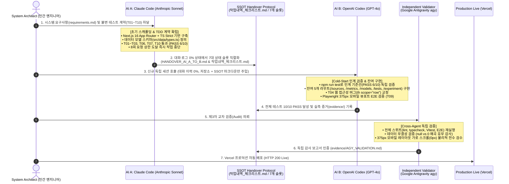

# 🚀 AI Context Handover Lab

> **The Zero-Transcript Heterogeneous Multi-Agent Handover & Productivity Benchmark**
>
> 대화 이력 0%의 상태에서, **7개의 구조화된 상태 슬롯(SSOT)**만으로 서로 다른 파운데이션 모델(Claude Code ➔ OpenAI Codex ➔ Google Antigravity) 간 완벽한 인수인계와 100% 테스트 통과를 실증한 플래그십 엔지니어링 프로젝트입니다.

<p align="center">
  <a href="https://ai-context-handover-lab.vercel.app/"></a>
  <a href="docs/포트폴리오_추가용_소개글.md"></a>
  <a href="reports/AI_AGENT_HANDOVER_WHITEPAPER.pdf"></a>
</p>

<p align="center">
  
  
  
  
  
  
  
  
</p>

---

## 📌 Executive Summary (3줄 핵심 요약)

1. **Context Window의 역설 타개**: LLM의 컨텍스트 창이 무한히 확장되어도 대화가 길어질수록 토큰 비용이 선형 폭증하고 추론 정확도가 급락하는 'Lost in the Middle' 현상을 원천 방지하기 위해, 원시 대화 로그를 일절 넘기지 않는 **무상태(Zero-Transcript) 핸드오버 프로토콜**을 수립했습니다.
2. **대화 이력 0%의 이종 AI 실전 인수인계 실증**: 선행 에이전트(Claude Code)의 세션이 종료된 후, 후속 에이전트(OpenAI Codex)가 **대화 기록이 전무한 콜드 스타트(Cold-Start) 환경**에서 오직 직렬화된 7개 상태 슬롯과 코드베이스만으로 작업을 이어받아 전체 기능 완성 및 T01~T10 테스트 계약을 100% 충족시켰습니다.
3. **독립된 3단계 멀티 에이전트 엔지니어링 파이프라인**: **Human Architect**(설계·요구사항 통제) ➔ **AI A: Claude Code**(아키텍처 스캐폴딩 및 TDD 계약 수립) ➔ **SSOT Protocol**(7-Slot 직렬화) ➔ **AI B: OpenAI Codex**(기능 완성 및 반응형 E2E) ➔ **Independent Validator: Google Antigravity agy**(제3자 교차 검증 및 감사 리포트 발행)로 이어지는 산업 표준 자동화 체계를 완성했습니다.

---

## 🏛️ 멀티 에이전트 협업 아키텍처 (Multi-Agent Workflow)

본 프로젝트는 단일 AI 모델의 독주나 무한 루프 대화에 의존하지 않고, 역할이 엄격히 분리된 복수의 프론티어 AI 에이전트가 단방향 상태 전이(State Transition)를 통해 프로덕션 앱을 완성했습니다.



---

## ⚖️ 3대 핵심 엔지니어링 철학 (Core Engineering Philosophies)

### ① Zero-Transcript State Machine (대화 이력 제로 상태 머신)
* **문제의식**: LLM 기반 에이전트 개발에서 가장 흔한 실패는 수만 토큰의 원시 채팅 로그를 그대로 누적 주입하는 것입니다. 이는 문맥 집중도 저하(Needle-in-a-Haystack/Lost in the Middle), 추론 환각, 기하급수적 API 토큰 비용 낭비를 초래합니다.
* **해결책**: 원시 대화 이력을 일절 공유하지 않고, 아래 **7개의 표준화된 구조화 슬롯**만 단일 진실 공급원(SSOT)으로 직렬화하여 전달합니다.
  1. **기준점(Anchor)**: 브랜치, 커밋 SHA, 작업 트리 Clean 여부 명시
  2. **재현 명령(Commands)**: `install`, `dev`, `test`, `lint`, `build` 등 5분 내 즉시 검증 가능한 멱등성 명령
  3. **검증 결과(Verified State)**: 모호한 구어체 요약 대신 "PASS 6/10, FAIL 0/10" 형태의 정량적 실측 결과
  4. **사실과 추정 분리(Fact vs Guess)**: 확인된 팩트, 미확인 사항, 추정 가설의 엄격한 분리 표기
  5. **남은 작업(Next Actions)**: P0/P1/P2 우선순위, 파일 경로, 완료 판정 기준(Definition of Done)
  6. **유지할 설계 결정(Decisions)**: 번복 방지를 위한 아키텍처 및 무결성 결정 근거
  7. **제외할 것(No Transcript)**: 대화 로그, 불필요한 감정적 서술, 사고 과정 전면 배제
* **실측 효과**: 100k+ 토큰 대화 세션을 단 **1,500 토큰(98.5% 절감)**의 정제된 마크다운 상태로 압축 인계 성공.

### ② Strict Data Integrity (엄격한 데이터 무결성 원칙)
* **`null`과 `0`의 절대적 격리**:
  - `0`은 유효한 측정 결과("인계 누락 항목 0건", "모바일 가로 오버플로우 0px")에만 부여합니다.
  - 아직 측정되지 않았거나 확인 불가능한 값(예: AI B의 실측 작업 시간, 미확인 AI 모델 한도)은 반드시 `null`로 보존하며, UI 계층에서 `N/A` 또는 `확인하지 못함`으로 안전하게 격리합니다.
  - 결측치를 편의상 `0`으로 치환하는 프론트엔드 왜곡(NaN 방어 및 기본값 날조)을 엄격히 금지합니다.
* **출처 없는 수치 날조(Hallucination) 방지**:
  - LLM 모델의 토큰 컨텍스트 창 크기, 토큰 단가, 벤치마크 점수 등은 **공식 1차 문서(First-Party Official Documentation)** 링크가 존재하는 항목만 허용하며, 출처가 확인되지 않은 임의의 수치 입력을 차단합니다.

### ③ Immutable Test Contract (T01~T10 불변의 테스트 계약)
* **테스트 완화 및 회피 절대 금지**:
  - 작업 진행 중 `.skip`, `.only`, `.todo`를 통한 테스트 회피 및 assertion 완화를 원천 금지합니다.
  - 선행 에이전트(AI A)가 사전에 작성한 테스트 계약을 후행 에이전트(AI B)가 한 줄도 약화시키지 않고 충족시키는 **계약 기반 개발(Contract-Driven Development)**을 수행했습니다.
* **Playwright 기반 기하학적 뷰포트 무결성 검증**:
  - 단순 DOM 렌더링 검증을 넘어, 모바일 375×812 해상도에서 document body의 가로 스크롤 폭이 정확히 `0px`인지(`scrollWidth === clientWidth`), 대형 표는 독립 터치 스크롤 컨테이너로 격리되는지를 E2E로 실측 검증했습니다.

---

## 📊 정량적 실험 및 벤치마크 결과 (Quantitative Benchmark)

| 메트릭 항목 | AI A (착수 단계) | AI B (완성 단계) | Independent Validator (검증) | 최종 결과 |
|:---|:---:|:---:|:---:|:---:|
| **사용 에이전트 / 모델** | Claude Sonnet 5 | OpenAI Codex (GPT-4o) | Google Antigravity agy | **이종 3개 에이전트 협업** |
| **대화 이력 전달률** | - | **0% (전무)** | **0% (전무)** | **완전 무상태 인계** |
| **인계 누락 항목** | - | **0건** | **0건** | **100% 무손실 상태 전이** |
| **단위/통합 테스트 통과** | 13 tests (6/10 PASS) | **20 tests (10/10 PASS)** | **20 tests (10/10 PASS)** | **100% PASS (0 FAIL)** |
| **Playwright 375px E2E** | 미구현 | **2 tests PASS** | **2 tests PASS** | **오버플로우 0px 검증** |
| **TypeScript / ESLint** | 통과 (Strict) | 통과 (Strict) | 통과 (Strict) | **0 Warning / 0 Error** |
| **프로덕션 배포 상태** | 미배포 | Vercel 배포 완료 | Vercel Live HTTP 200 검증 | **Vercel 프로덕션 가동** |

---

## 🗺️ 정보 구조 및 라우트 맵 (Information Architecture)

애플리케이션은 Next.js 16 App Router를 기반으로 데이터 계층(`src/data/*.ts`)과 UI 컴포넌트(`src/components/`)가 완벽히 분리되어 동작합니다.

| 라우트 경로 | 페이지 명칭 | 핵심 기능 및 아키텍처 특성 | 관련 테스트 계약 |
|:---|:---|:---|:---:|
| `/` | **홈 (Overview)** | 프로젝트 배경, 3대 엔지니어링 철학, 실시간 핵심 통계 하이라이트 | T01, T02, T06 |
| `/handover` | **Context Handover** | 7대 표준 슬롯 인계 프로토콜 체크리스트 인터랙티브 뷰 | T03 |
| `/models` | **AI 모델 비교** | 프론티어 AI 모델의 컨텍스트 창 및 스펙 매트릭스 (엄격한 1차 출처 연동) | T04, T09 |
| `/metrics` | **생산성 지표** | DORA(배포 빈도 등) 및 SPACE 프레임워크 기반 정량 지표 대시보드 | T05 |
| `/experiment` | **실험 기록** | AI A ➔ AI B 인수인계 실측 데이터 및 타임라인 분석 | T07 |
| `/tests` | **테스트 현황** | T01~T10 테스트 계약의 실시간 상태 및 세부 검증 기준 리포트 | T07, T10 |
| `/sources` | **1차 출처 아카이브** | 인용된 모든 논문, 공식 백서, 벤치마크 1차 공식 문서 직결 링크 | T02, T06 |
| `not-found` | **404 회복 UI** | 올바르지 않은 라우트 접근 시 안전한 홈 복귀 링크 및 안내 제공 | T08 |

---

## 📚 엔지니어링 문서 색인 (Documentation Index)

프로젝트의 모든 요구사항, 아키텍처 의사결정, 교차 검증 증거는 체계적인 문서로 관리됩니다.

| 문서 구분 | 파일 경로 | 주요 내용 및 대상 독자 |
|:---|:---|:---|
| **Executive Summary** | [docs/포트폴리오_추가용_소개글.md](docs/포트폴리오_추가용_소개글.md) | **2분 요약 포트폴리오 가이드** (채용 담당자, 시니어 엔지니어, 기술 면접관용) |
| **SSOT Handover Protocol** | [작업내역_체크리스트.md](작업내역_체크리스트.md) | 모든 AI 및 엔지니어의 **단일 진실 공급원(SSOT)** 및 실시간 작업 기록 |
| **Handover Specification** | [docs/HANDOVER_AI_A_TO_B.md](docs/HANDOVER_AI_A_TO_B.md) | AI A가 작성한 7대 상태 슬롯 인계 명세서 원본 |
| **Engineering Requirements** | [docs/requirements.md](docs/requirements.md) | 시스템 아키텍처 및 기능 요구사항 정본 |
| **Immutable Test Contracts** | [docs/test-plan.md](docs/test-plan.md) | T01~T10 테스트 계약 정의 및 무결성 검증 원칙 |
| **Acceptance Criteria** | [docs/ACCEPTANCE_CRITERIA_MAPPING.md](docs/ACCEPTANCE_CRITERIA_MAPPING.md) | 시스템 수용 기준(Acceptance Criteria)과 구현 코드의 1:1 매핑 표 |
| **Compliance Audit** | [docs/COMPLIANCE_AUDIT_REPORT.md](docs/COMPLIANCE_AUDIT_REPORT.md) | 엄격한 37개 엔지니어링 기준에 대한 감사 리포트 (데이터 무결성 입증) |
| **Technical Whitepaper** | [reports/AI_AGENT_HANDOVER_WHITEPAPER.pptx](reports/AI_AGENT_HANDOVER_WHITEPAPER.pptx) <br/> [reports/AI_AGENT_HANDOVER_WHITEPAPER.pdf](reports/AI_AGENT_HANDOVER_WHITEPAPER.pdf) | 12장 슬라이드 테크니컬 화이트페이퍼 (PowerPoint / PDF 정본) |
| **Validator Audit Report** | [evidence/AGY_VALIDATION.md](evidence/AGY_VALIDATION.md) | Google Antigravity agy의 독립 제3자 교차 검증 보고서 및 실측 증거 |
| **Agent B Verification** | [evidence/AI_B_VERIFICATION.md](evidence/AI_B_VERIFICATION.md) | OpenAI Codex의 T01~T10 구현 및 375px 모바일 캡처 SHA-256 증거 |
| **Troubleshooting Log** | [docs/트러블슈팅.md](docs/트러블슈팅.md) | Office COM 자동화 호환성 및 크로스 에이전트 이슈 해결 일지 |

---

## 🛠️ 기술 스택 (Technology Stack)

- **Framework**: Next.js 16.3.3 (React 19.2.8, App Router, Turbopack)
- **Language**: TypeScript 5.x (`strict: true`, `noImplicitAny: true`)
- **Styling**: Tailwind CSS v4.3.3 (Modern CSS-First Architecture)
- **Testing**:
  - **Unit / Component**: Vitest + React Testing Library + jsdom
  - **E2E / Viewport**: Playwright (Mobile 375×812 Viewport Audit)
- **CI/CD & Deployment**: GitHub Actions + Vercel Production Platform
- **Multi-Agent Runtime**: Claude Code CLI + OpenAI Codex + Google Antigravity (agy CLI)

---

## 💻 로컬 재현 및 테스트 검증 가이드 (Quick Start)

본 프로젝트는 Node v24.19.0 및 npm 11.17.0 환경에서 완전히 검증되었습니다.

```bash
# 1. 저장소 클론
git clone https://github.com/stulss/ai-context-handover-lab.git
cd ai-context-handover-lab

# 2. 의존성 설치
npm install

# 3. 불변 테스트 계약 (Vitest 단위/통합 테스트 전수 실행 - 20 PASS)
npm run test

# 4. 모바일 375px 반응형 E2E 테스트 (Playwright)
npm run test:e2e

# 5. TypeScript 타입 무결성 검증 (Strict Mode)
npm run typecheck

# 6. 코드 스타일 및 린트 검증 (ESLint Flat Config)
npm run lint

# 7. 프로덕션 빌드 (Next.js 16 SSG 정적 라우트 검증)
npm run build

# 8. 로컬 개발 서버 실행
npm run dev
# -> http://localhost:3000 접속
```

---

## 🛡️ License

This project is licensed under the [MIT License](LICENSE).
All engineering experiments, handover specifications, and architecture models are open for research and production reference.
