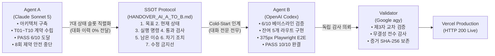

# 🚀 [Executive Summary] AI Context Handover Lab
## 대화 이력 제로(Zero-Transcript) 환경에서의 이종 멀티에이전트 인계 아키텍처 실증 연구

> **2분 요약:** 본 프로젝트는 LLM 에이전트 협업에서 발생하는 컨텍스트 창 비대화 및 대화 이력 의존 문제를 해결하기 위해, **대화 기록(Chat History)을 0% 공유한 상태에서 구조화된 7대 상태 슬롯과 TDD 테스트 계약만으로 서로 다른 AI(Claude Sonnet ➡️ OpenAI Codex ➡️ Gemini Specialist) 간 완벽한 소프트웨어 인수인계를 실증**한 엔지니어링 케이스 스터디이자 실시간 웹 플랫폼입니다.

---

### 🌐 핵심 링크 및 프로덕션 리소스
- **프로덕션 라이브 데모:** https://ai-context-handover-lab.vercel.app/ (Vercel 배포, HTTP 200)
- **GitHub 소스 저장소:** https://github.com/stulss/ai-context-handover-lab (PUBLIC, TypeScript Strict)
- **기술 백서 (12-Slide Whitepaper):** [`reports/AI_AGENT_HANDOVER_WHITEPAPER.pdf`](../reports/AI_AGENT_HANDOVER_WHITEPAPER.pdf)
- **독립 감사 보고서:** [`evidence/AGY_VALIDATION.md`](../evidence/AGY_VALIDATION.md)

---

### 1. 연구 배경 및 문제 정의 (Background & Problem)

- **컨텍스트 윈도우의 역설(Context Window Paradox):** AI 모델의 컨텍스트 창이 커져도 세션이 길어지면 'Lost in the Middle' 현상으로 인한 추론 정확도 급락, 기하급수적인 토큰 비용 발생, 그리고 세션 중단이나 모델 교체 시 개발 맥락이 증발하는 문제가 발생합니다.
- **패러다임 전환:** "끝없는 대화 프롬프트 누적" 방식 대신, **"단일 진실 공급원(SSOT) 마크다운 + 불변의 TDD 테스트 계약 + 코드베이스 스냅샷"**을 통한 상태 머신 기반 인수인계 아키텍처를 고안했습니다.

---

### 2. 멀티에이전트 인계 가설 및 파이프라인 (Hypothesis & Architecture)

> **핵심 가설:** "원시 대화 이력을 일절 주입하지 않는 콜드 스타트(Cold-Start) 환경에서도, 표준화된 7개 상태 슬롯과 고정 검사 계약이 주어지면 후속 에이전트가 단 1건의 인계 누락 없이 프로덕션 소프트웨어를 완결할 수 있는가?"



1. **Agent A (시스템 아키텍트):** Next.js 16 App Router 기반 스캐폴딩, TypeScript 도메인 모델, 컴포넌트 라이브러리 및 T01~T10 테스트 계약 확립 후 호출 상한(8회)에 맞춰 안전 중단.
2. **7-Slot SSOT Handover Protocol:** 대화 전문을 완전히 배제하고, `[목표 / 현재 상태 / 실행 명령 / 통과 검사 / 남은 이슈 / 차기 조치 / 수정 금지선]` 7개 슬롯으로 시스템 상태를 직렬화.
3. **Agent B (구현 및 통합 엔지니어):** 대화 기록이 전무한 상태에서 인계 문서를 수신, 선행 테스트 상태를 독립 재현한 뒤 잔여 라우트(`/sources`, `/metrics`, `/models`, `/experiment`, `/tests`), 404 폴백, 375px 모바일 반응형을 완결.
4. **Independent Validator (품질 감사자):** Google Antigravity specialist 에이전트가 빌드, 린트, 타입, Vitest 20건, Playwright E2E 및 결측치 왜곡 여부를 제3자 관점에서 독립 감사.

---

### 3. 정량적 성과 지표 (Quantitative Achievements)

| 평가 항목 | 인계 기준선 (Agent A) | 최종 결과 (Agent B + agy) | 성과 의미 및 신뢰성 |
|:---|:---:|:---:|:---|
| **대화 이력 공유율** | - | **0% (완전 배제)** | 대화 컨텍스트 없이 파일시스템 기반 콜드 스타트 달성 |
| **컨텍스트 압축률** | 100k+ 토큰 (원시 대화) | **~1,500 토큰 (정제 SSOT)** | **98.5% 토큰 절감 효과**, 추론 집중도 극대화 |
| **인계 누락률 (Handover Drift)** | - | **0건 (0%)** | 요구사항 및 아키텍처 맥락의 무손실 전이 |
| **불변 테스트 통과 (T01~T10)** | 6 / 10 PASS (60%) | **10 / 10 PASS (100%)** | 선행 에이전트가 세운 테스트 계약 100% 충족 |
| **단위/컴포넌트 테스트** | 5개 파일 / 13 PASS | **10개 파일 / 20 PASS** | 기존 테스트 삭제/스킵/단언문 완화 0건 유지 |
| **모바일 반응형 검증** | 미구현 | **Playwright E2E 2 PASS** | 375px 뷰포트에서 가로 스크롤 오버플로우 0px 보장 |
| **정적 분석 및 컴파일** | Strict 통과 | **0 Error, 0 Warning** | TypeScript Strict + ESLint Flat Config 완전 무결 |

---

### 4. 핵심 엔지니어링 원칙 및 기술적 차별점 (Core Engineering Pillars)

#### ① 엄격한 데이터 무결성 (Strict Data Integrity: `null` vs `0`)
- **결측치와 0의 분리:** 프론트엔드 편의를 위한 `value || 0` 식의 임의 치환을 엄격히 배제했습니다. "측정하지 못한 값(Unknown)"은 `null`로 보존하여 UI에서 `N/A`로 격리하고, `0`은 오직 "실제 측정 결과가 0(인계 누락 0건 등)"인 경우에만 렌더링되도록 컴포넌트 단위 테스트로 고정했습니다.
- **환각(Hallucination) 원천 차단:** 1차 공식 문서가 확인되지 않은 AI 모델의 파라미터나 가격 정보는 임의 기재하지 않고 의도적으로 결측 처리했습니다.

#### ② 불변의 테스트 계약 (Immutable Test Contract)
- **테스트 회피 금지:** 에이전트가 통과율을 높이기 위해 `.skip`, `.only`, `.todo`를 사용하거나 Assertion을 완화하는 행위를 시스템적으로 금지했습니다.
- **물리적 뷰포트 검증:** 단순 단위 테스트를 넘어 Headless Playwright를 통해 375×812 픽셀 모바일 뷰포트에서 `scrollWidth === clientWidth`를 물리적으로 검증하여 모바일 레이아웃 무결성을 입증했습니다.

#### ③ 제3자 독립 교차 감사 (Cross-Agent Independent Audit)
- 구현을 수행한 에이전트(Codex)와 별도로 독립된 Validator 에이전트(Gemini agy)를 투입하여 결과물, 스크린샷 렌더링, SHA-256 체크섬을 교차 검증하고 감사 보고서([`evidence/AGY_VALIDATION.md`](../evidence/AGY_VALIDATION.md))를 아카이빙했습니다.

---

### 5. 프로젝트 아키텍처 및 기술 스택 (Tech Stack)

```
ai-context-handover-lab/
├── src/
│   ├── app/                 # Next.js 16 App Router (슬림 페이지, SSG 정적 렌더링)
│   ├── components/          # 단일 책임 원칙(SRP) 기반의 고반응형 UI 컴포넌트
│   └── data/                # 도메인 모델 및 1차 출처 데이터 (types.ts, metrics.ts 등)
├── docs/                    # 아키텍처 결정(ADR), 수용 기준, 인계 명세서 정본
├── reports/                 # 12슬라이드 기술 백서 (PPTX / PDF) 및 증거 목록
└── evidence/                # E2E 375px 모바일 캡처 및 제3자 검증 SHA-256 증거
```

- **Core:** Next.js 16 (App Router, SSG), React 19, TypeScript (Strict Mode)
- **Styling:** Tailwind CSS v4
- **Testing:** Vitest, React Testing Library, Playwright (E2E)
- **Multi-Agent Runtime:** Claude Code (Anthropic) ➔ OpenAI Codex (OpenAI) ➔ Antigravity agy (Google)
- **CI/CD & Deploy:** Vercel Production Environment
