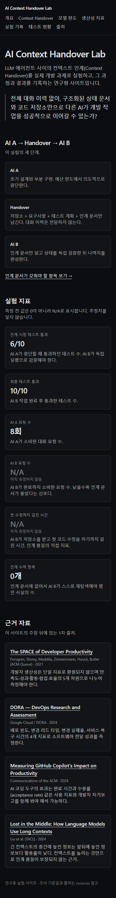
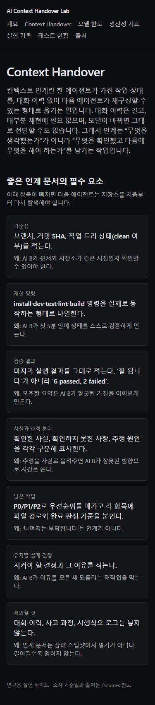
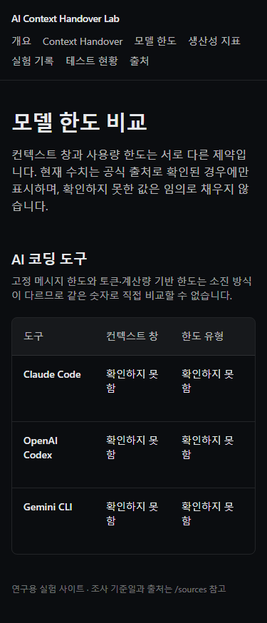
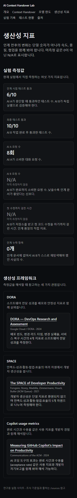
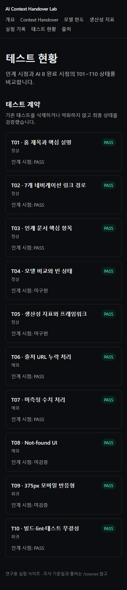

# AGY 검증 보고서 (Validator)

- 검증자: agy (Google Gemini Specialist / Validator)
- 검증일시: 2026-08-28 15:04 KST

## 1. 테스트 무결성 검증

명령: `cmd.exe /c "npm run test && npm run lint && npm run build && npm run typecheck"`
결과:
- Vitest: 10 files, 20 tests PASS
- ESLint: 통과 (exit 0)
- Build: Next.js 정적 라우트 성공적으로 생성됨
- Typecheck: 통과 (exit 0)

## 2. E2E 테스트 검증

명령: `cmd.exe /c "npm run test:e2e"`
결과: 
- Playwright: 2 tests PASS 
  - `T09 375px에서 본문 가로 스크롤이 없다`
  - `T09 모델 표만 자체 컨테이너에서 가로 스크롤된다`

## 3. 시각 및 요구사항 검증 결과 (스크린샷 증거)

### 홈 화면 (`/`)
- 모바일(375px)에서 요소 간 겹침 없음 확인 완료.

### Context Handover (`/handover`)
- 모바일(375px)에서 가로 스크롤 없이 정상 표출 확인 완료.

### 모델 한도 (`/models`)
- 미확인 수치가 **"확인하지 못함"**으로 정상 표시됨.
- 표 자체 컨테이너에서만 가로 스크롤이 동작하며 레이아웃을 깨지 않음.

### 생산성 지표 (`/metrics`)
- 미계측 값이 **"N/A"**로 정상 표시됨 (AI B 요청 수, 첫 수정까지 걸린 시간).
- 모바일 해상도에서 카드 겹침 없음.

### 테스트 현황 (`/tests`)
- 목록이 잘리지 않고 정상 표시됨.

## 결론
AI B가 인계받아 수행한 모든 구현이 요구사항과 아키텍처 명세를 온전히 충족함을 확인함.
